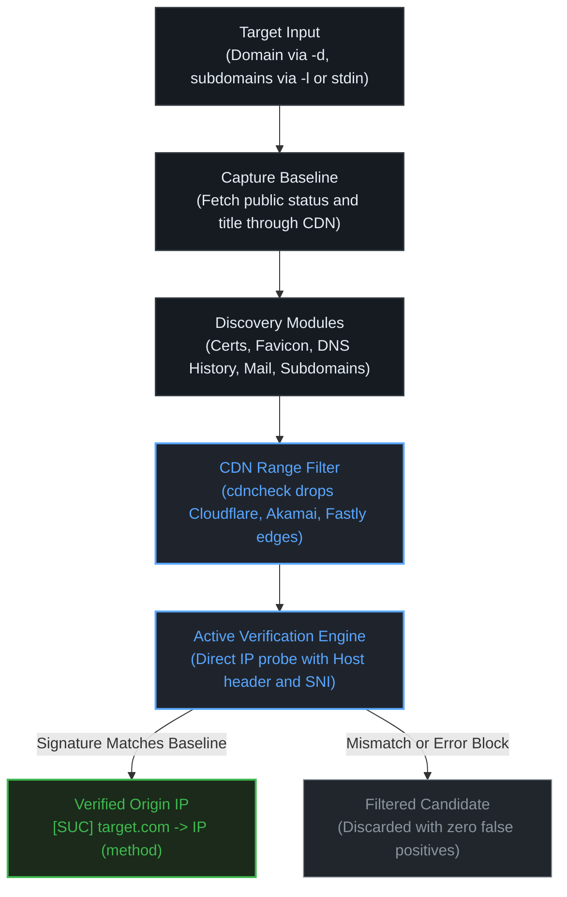

<p align="center">
  
  <p align="center">Find Origin IP Behind WAFs & CDNs</p>
</p>

<p align="center">
  <a href="#why-i-built-pinaak">Why I Built Pinaak</a> •
  <a href="#key-capabilities">Key Capabilities</a> •
  <a href="#discovery-techniques">Discovery Techniques</a> •
  <a href="#how-it-works">How It Works</a> •
  <a href="#installation">Installation</a> •
  <a href="#configuration">Configuration</a> •
  <a href="#usage">Usage</a> •
  <a href="#credits--acknowledgements">Credits</a>
</p>

## Why I Built Pinaak

During bug bounty hunting and security assessments, almost every high-value target sits behind Cloudflare, Akamai, CloudFront, or Fastly. When you test a domain through a CDN or WAF, your requests get inspected, rate limited, or blocked by generic rules.

Finding the real origin IP changes everything. Once you locate the origin server, you connect directly to the backend IP, bypass the WAF completely, and uncover vulnerabilities that the proxy would normally hide.

I wanted a single workflow that gathers candidate IPs through certificates, favicon hashes, historical DNS, and mail records, accepts input subdomains from existing recon pipelines, and actively confirms the real origin server by probing candidate IPs directly with the target Host header.

This tool is totally created by vibe coding. My goal was simple: build a fast, practical origin IP discovery tool that runs every proven technique in one pass and gives you verified results.

## Key Capabilities

All in one discovery. Pinaak queries certificate search engines, calculates favicon MurmurHash3 signatures, inspects historical DNS, and analyzes MX and SPF records in a single run.

Pipeline ready. Pinaak accepts subdomains piped directly from stdin or passed via a file, allowing direct integration with existing reconnaissance workflows.

True origin verification. Pinaak connects directly to candidate IPs on ports 443 and 80 with the target Host header and TLS SNI, compares the response title against the public baseline, and discards unconfirmed candidates.

Cloud origin preservation. Pinaak isolates and filters CDN and WAF edge IP addresses while retaining legitimate cloud virtual machines in the candidate pool.

Clean terminal output. No ASCII banners, no decorative boxes, and no clutter. Pinaak uses minimal three-letter status tags like `[INF]`, `[SUC]`, `[WRN]`, and `[ERR]`, and supports JSON output for easy automation.

## Discovery Techniques

| Technique | Description | Data Sources |
| :--- | :--- | :--- |
| **Certificate Search** | Searches internet scanners for SSL certificates matching the target domain. | Censys v2, Shodan |
| **Favicon Hashing** | Computes the 32-bit MurmurHash3 of the target favicon.ico and finds identical hosts. | Shodan, FOFA |
| **DNS History** | Queries historical A records from before the domain moved behind a proxy. | SecurityTrails |
| **Mail & SPF Records** | Resolves MX hosts and extracts IPv4 directives from SPF TXT records. | dnsx (MX, TXT) |
| **Subdomain Resolution** | Resolves user-supplied subdomains concurrently and filters out CDN IP ranges. | dnsx, cdncheck |
| **Active Verification** | Probes candidate IPs directly with Host headers and TLS SNI to confirm the origin application. | Direct HTTP/HTTPS |

## How It Works



## Installation

Install using Go:

```bash
go install -v github.com/R0X4R/pinaak@latest
```

Build from source:

```bash
git clone https://github.com/R0X4R/pinaak.git
cd pinaak
go build -v .
```

## Configuration

Pinaak works out of the box with passive DNS, mail records, and subdomain resolution. To enable search engine queries, add your API keys to `~/.config/pinaak/config.yaml`:

```yaml
shodan-key: "YOUR_SHODAN_KEY"
censys-id: "YOUR_CENSYS_ID"
censys-secret: "YOUR_CENSYS_SECRET"
fofa-email: "YOUR_FOFA_EMAIL"
fofa-key: "YOUR_FOFA_KEY"
securitytrails-key: "YOUR_SECURITYTRAILS_KEY"
```

You can also export environment variables:

```bash
export SHODAN_API_KEY="YOUR_KEY"
export CENSYS_API_ID="YOUR_ID"
export CENSYS_API_SECRET="YOUR_SECRET"
export FOFA_EMAIL="YOUR_EMAIL"
export FOFA_KEY="YOUR_KEY"
export SECURITYTRAILS_API_KEY="YOUR_KEY"
```

## Usage

```bash
pinaak -h
```

### Flags Reference

| Flag | Shorthand | Default | Description |
| :--- | :--- | :--- | :--- |
| `-domain` | `-d` | `""` | Target domain to discover origin IP for |
| `-list` | `-l` | `""` | File containing already-known subdomains, or `-` for stdin |
| `-config` | | `""` | Configuration file path (default: `~/.config/pinaak/config.yaml`) |
| `-threads` | `-t` | `25` | Number of concurrent workers |
| `-timeout` | | `10` | Network timeout in seconds |
| `-skip-verify` | | `false` | Skip HTTP Host header verification on candidate IPs |
| `-output` | `-o` | `""` | File path to save discovered results |
| `-json` | `-j` | `false` | Output results in JSON format |
| `-silent` | `-s` | `false` | Suppress non-essential status logs |
| `-no-color` | `-nc` | `false` | Disable ANSI color output |
| `-shodan-key` | | `""` | Shodan API key for favicon and cert lookups |
| `-censys-id` | | `""` | Censys API ID for certificate search |
| `-censys-secret` | | `""` | Censys API secret for certificate search |
| `-fofa-email` | | `""` | FOFA account email |
| `-fofa-key` | | `""` | FOFA API key |
| `-securitytrails-key` | | `""` | SecurityTrails API key for historical DNS records |

### Examples

Find origin IP for a single domain:

```bash
pinaak -d target.com
```

Pipe subdomains directly from subfinder:

```bash
subfinder -d target.com -silent | pinaak -d target.com -l -
```

Provide a list of already-known subdomains:

```bash
pinaak -d target.com -l subdomains.txt
```

Filter subdomains without a target domain:

```bash
cat subdomains.txt | pinaak -l - -skip-verify
```

Save results to a file in JSON format:

```bash
pinaak -d target.com -j -o results.json
```

Run with custom concurrency and timeout:

```bash
pinaak -d target.com -t 50 -timeout 5
```

## Credits & Acknowledgements

Pinaak relies on these open-source libraries:

* **[ProjectDiscovery cdncheck](https://github.com/projectdiscovery/cdncheck)** for CDN and WAF CIDR range detection.
* **[ProjectDiscovery dnsx](https://github.com/projectdiscovery/dnsx)** for concurrent DNS resolution.
* **[ProjectDiscovery goflags](https://github.com/projectdiscovery/goflags)** for CLI flag parsing and configuration management.
* **[Fatih Arslan color](https://github.com/fatih/color)** for terminal color output.
* **[Murmur3](https://github.com/spaolacci/murmur3)** for Shodan-compatible favicon hash calculation.
* **[sqlmapproject](https://github.com/sqlmapproject/sqlmap)** for the browser User-Agent dataset.
